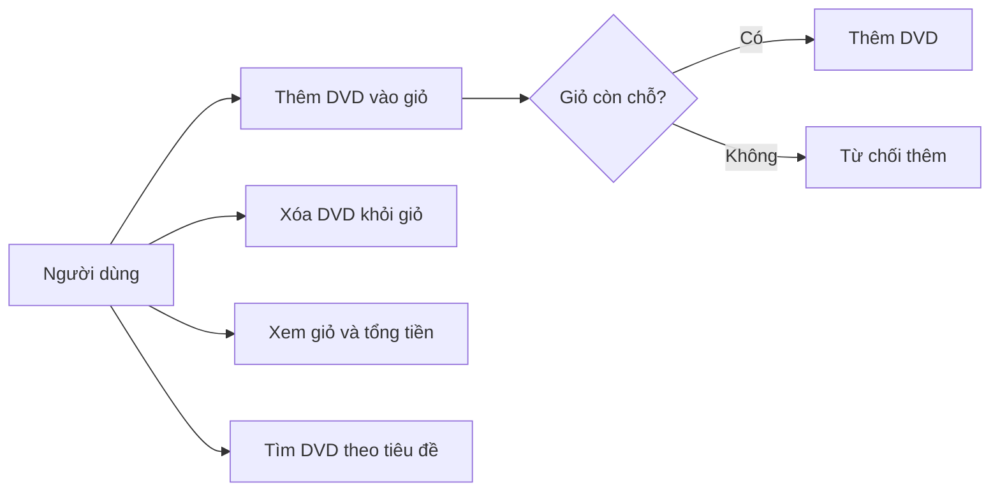

# Ca sử dụng AIMS-mini

Tác nhân: người dùng dòng lệnh. Hệ thống minh họa thao tác trên các DVD
trong bộ nhớ; chưa có thanh toán, tài khoản hay cơ sở dữ liệu.

## Luồng chính: thêm DVD

1. Người dùng chọn một DVD.
2. Hệ thống kiểm tra sức chứa tối đa 20 đĩa.
3. Nếu còn chỗ, DVD được thêm và thao tác trả về `True`.
4. Nếu đã đầy, giữ nguyên giỏ và trả về `False`.

## Quy tắc hiển thị và tìm kiếm

- Giỏ rỗng hiển thị `The cart is empty`.
- Giỏ có dữ liệu hiển thị từng DVD và tổng tiền với hai chữ số thập phân.
- Tìm theo một phần tiêu đề, yêu cầu nghiệp vụ không phân biệt hoa thường.
  Việc kiểm tra yêu cầu này được bổ sung trong hotfix Lab 05.
